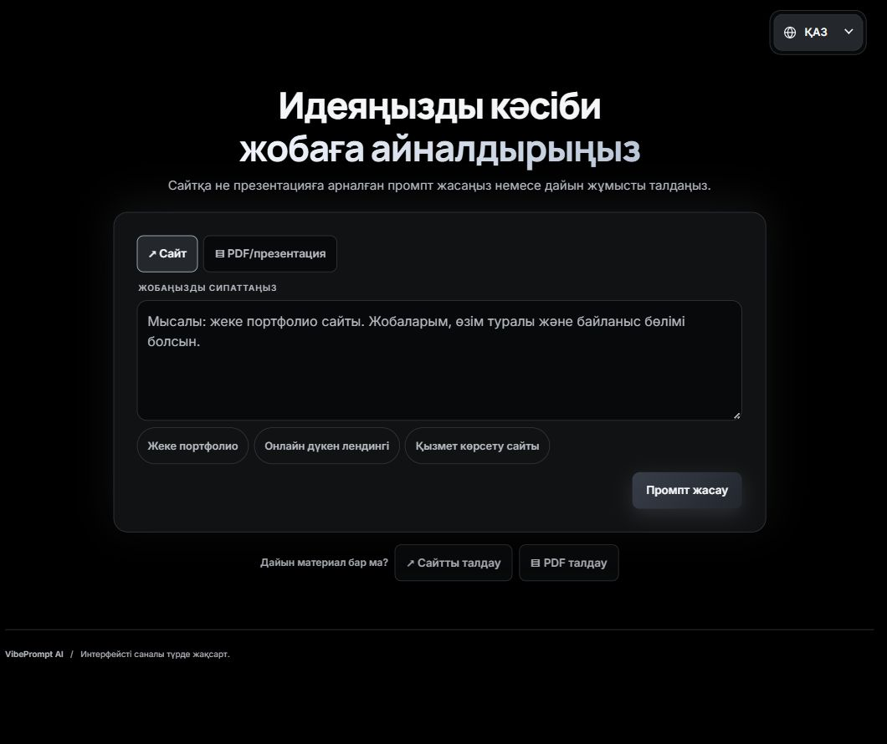
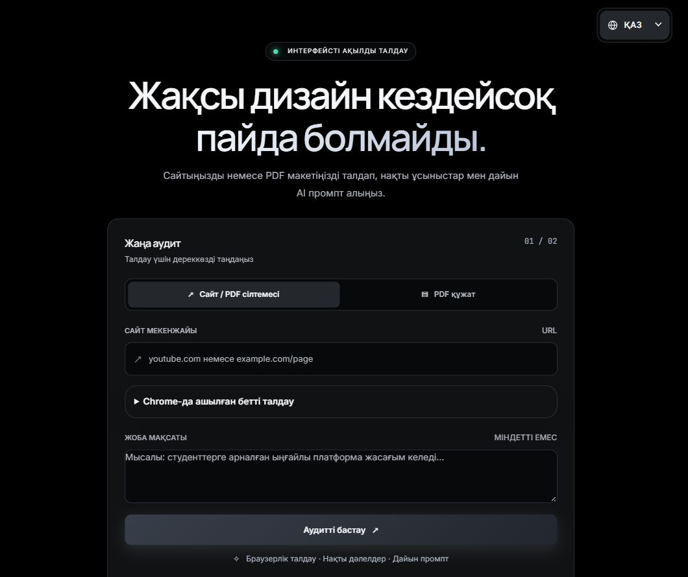
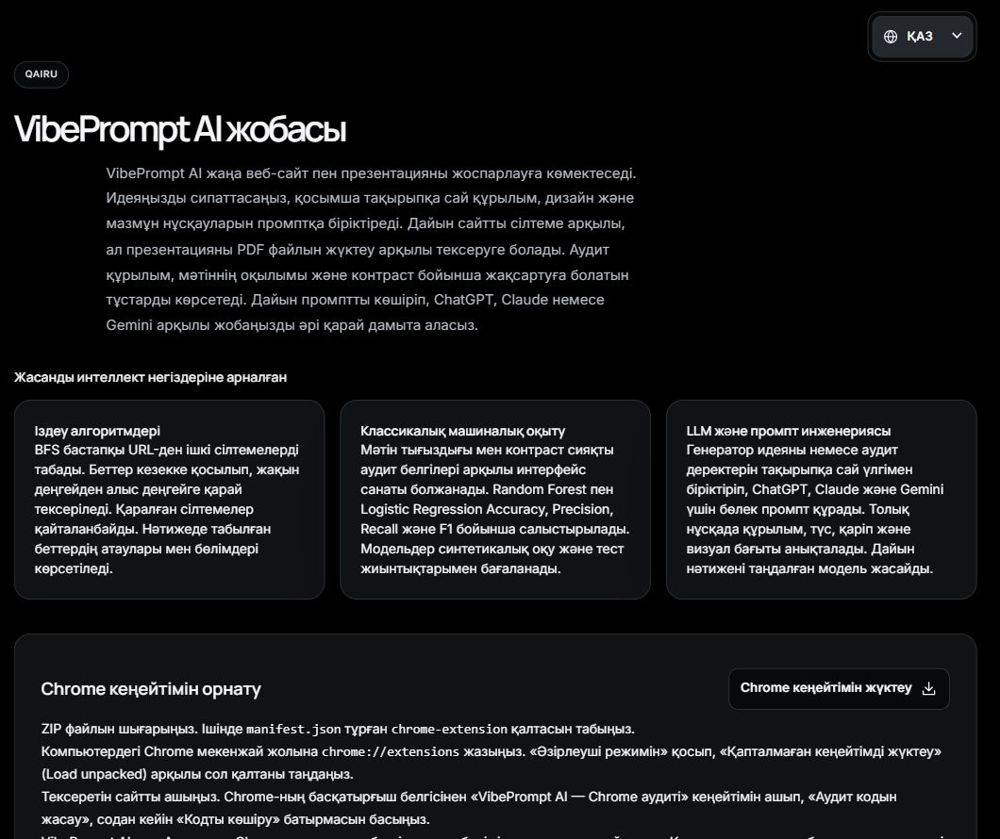
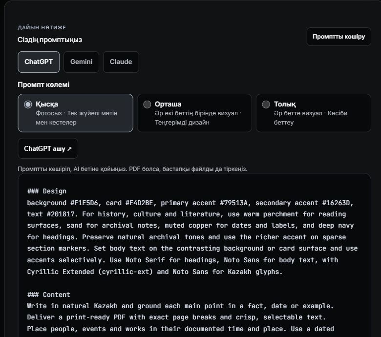
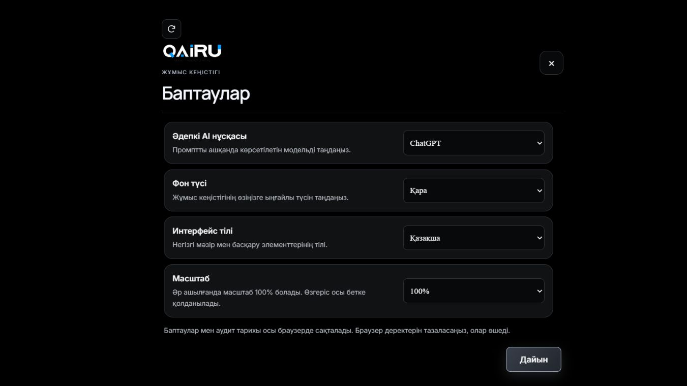
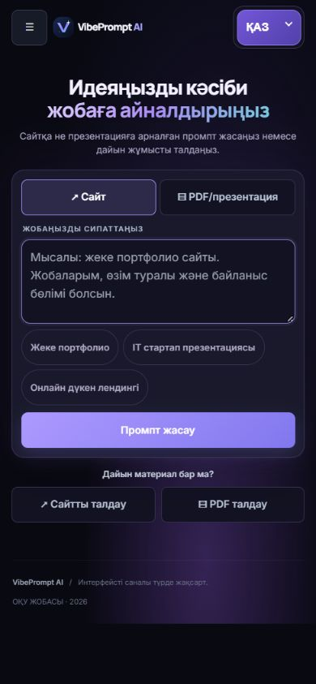
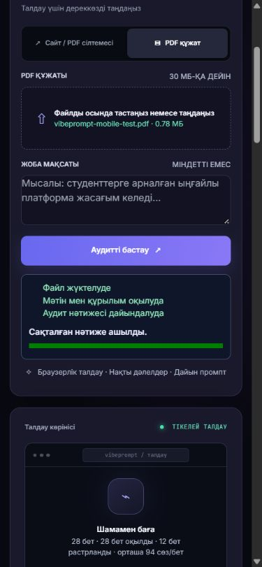
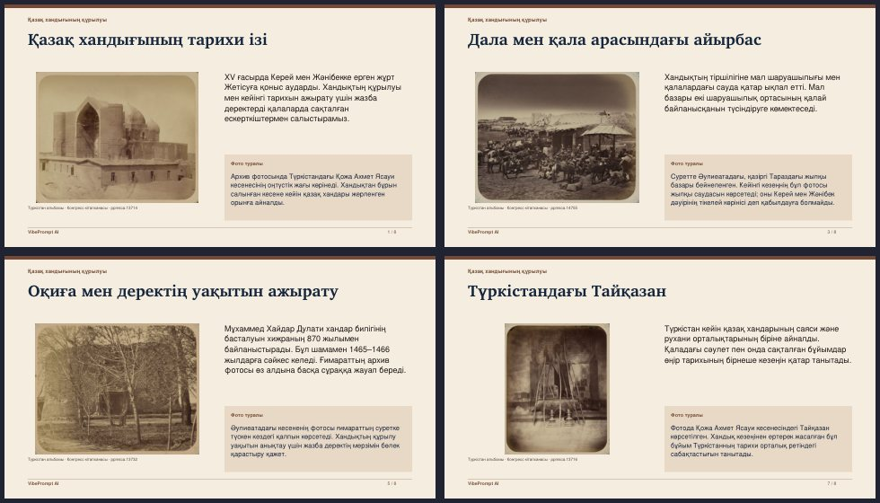

  

<h1 align="center">VibePrompt AI</h1>

<strong>Сайт пен PDF аудиті және үш AI моделіне арналған промпт генераторы</strong>

  <a href="https://vibeprompt-ai-eta.vercel.app/"><strong>Қосымшаны ашу</strong></a>
  · <a href="https://vibeprompt-ai-eta.vercel.app/downloads/VibePrompt-Chrome.zip">Chrome кеңейтімі</a>
  · <a href="https://vibeprompt-ai-eta.vercel.app/static/photo-export.html#khanate-medium">Фотосуретті PDF үлгісі</a>

---

**VibePrompt AI** жобасы QAIRU университетіндегі **«Жасанды интеллект негіздері»** пәнінің **Final Project** тапсырмасына арналып жасалды.

- **Жасаушылар** — Насрулла Мұхамеджан, Сарсенбек Асхат
- **Жетекші** — Жукабаева Тамара Кокеновна

## Алғаш рет кірсеңіз

VibePrompt AI сайт немесе презентация жасауға арналған тапсырма мәтінін дайындайды. Осы тапсырма мәтіні **промпт** деп аталады. Қолыңызда дайын сайт не PDF болса, қосымша оны тексеріп, нені жақсартуға болатынын көрсетеді.

- **Жаңа жоба бастау** — «Сайт» немесе «PDF/презентация» таңдаңыз. Не жасағыңыз келетінін бір-екі сөйлеммен жазып, «Промпт жасау» батырмасын басыңыз. Дайын мәтінді ChatGPT, Claude немесе Gemini-ге көшіріңіз.
- **Дайын жұмысты тексеру** — «Аудит» бөліміне өтіңіз. Сайт сілтемесін қойыңыз немесе PDF жүктеңіз. Нәтижеде жақсартуға болатын тұстар мен түзетуге арналған промпт шығады.

## Қосымша көрінісі

### Ноутбуктегі интерфейс

**Басты бет** · Сайт немесе презентация идеясын енгізу.

| Аудит | Оқытушы режимі |
| --- | --- |
|  |  |

**Дайын промпт** · Модельді, промпт көлемін таңдау және дайын мәтінді көшіру.

Баптаулар көрінісі

### Телефондағы интерфейс

| Телефондағы басты бет | Телефондағы PDF аудиті |
| :---: | :---: |
|  |  |

Бұл скриншоттар интерфейстің демонстрациялық түсірілімдері. Жарияланған нұсқа жоғарыдағы сілтемеде ашылады.

### Фотосуреті бар PDF үлгісі

«Қазақ хандығының құрылуы» презентациясының орташа визуал тәртібінде фото 1, 3, 5 және 7-беттерде орналасады. Әр архив фотосының жанында қазақша түсіндірме бар. [Үлгіні сайтта ашу](https://vibeprompt-ai-eta.vercel.app/static/photo-export.html#khanate-medium)

## Жасанды интеллект негіздерінің тақырыптарына бағытталып қолданған алгоритмдер
 Іздеу алгоритмдері
BFS бастапқы URL-ден ішкі сілтемелерді табады. Беттер кезекке қосылып, жақын деңгейден алыс деңгейге қарай тексеріледі. Қаралған сілтемелер қайталанбайды. Нәтижеде табылған беттердің атаулары мен бөлімдері көрсетіледі.

Классикалық машиналық оқыту
Мәтін тығыздығы мен контраст сияқты аудит белгілері арқылы интерфейс санаты болжанады. Random Forest пен Logistic Regression Accuracy, Precision, Recall және F1 бойынша салыстырылады. Модельдер синтетикалық оқу және тест жиынтықтарымен бағаланады.

LLM және промпт инженериясы
Генератор идеяны немесе аудит деректерін тақырыпқа сай үлгімен біріктіріп, ChatGPT, Claude және Gemini үшін бөлек промпт құрады. Толық нұсқада құрылым, түс, қаріп және визуал бағыты анықталады. Дайын нәтижені таңдалған модель жасайды.

## Қосымша қалай жұмыс істейді

| Әрекет | Нәтиже |
| --- | --- |
| Идеяны сипаттау | Сайтқа, PDF-ке немесе өңдеуге болатын PowerPoint презентациясына арналған промпт |
| Сайт сілтемесін енгізу | Бет құрылымы, мәтін, контраст, навигация және қолжетімділік өлшемдері бойынша аудит |
| PDF жүктеу | Беттердің мәтіні мен құрылымы, типографика және көрнекі материалдар бойынша есеп |
| Chrome кеңейтімін пайдалану | Ашық қойындыдан алынған өлшемдермен аудит |
| Нәтижені сақтау және экспорттау | Аудитті тарихтан қайта ашу, промптты көшіру және қолжетімді есеп пішімдерін жүктеу |

### Жаңа идеядан промпт жасау

1. Басты бетте **Сайт** немесе **PDF/презентация** таңдаңыз. Презентация үшін PDF пен PowerPoint пішімдері бар.
2. Тақырыпты, аудиторияны және дайын жұмыстан не күтетіндігіңізді жазыңыз.
3. Промптты жасаңыз да, модель мен қажетті көлемді таңдаңыз. Палитра мен қаріп тақырыпқа қарай автоматты ұсынылады.
4. Промптты көшіріп, таңдаған AI сервисіне қойыңыз.

### Дайын жұмысты талдау

**Аудит** бөлімінде сайт сілтемесін енгізіңіз немесе PDF жүктеңіз. Есепте өлшенген көрсеткіштер, жақсартуға болатын тұстар және түзету промпты беріледі. Ұпай қолжетімді дерекке сүйенген жуық баға. Аудит тарихы браузерде сақталады және 30 жазбаға дейін қолдайды. Өте үлкен нәтижелерге браузердің сақтау көлемі әсер етеді.

### Chrome кеңейтімін қосу

1. [Бір ZIP файлды жүктеп](https://vibeprompt-ai-eta.vercel.app/downloads/VibePrompt-Chrome.zip), архивті ашыңыз.
2. Компьютердегі Chrome-да `chrome://extensions` бетін ашып, **Әзірлеуші режимін** қосыңыз.
3. **Load unpacked** арқылы `manifest.json` тұрған `chrome-extension` қалтасын таңдаңыз.
4. Тексеретін қойындыда кеңейтімді ашып, **Аудит кодын жасау** түймесін басыңыз. Көшіру белгісі кодты алмасу буферіне жібереді.
5. VibePrompt AI-дағы **Аудит → Chrome-да ашылған бетті талдау** бөліміне кодты қойыңыз.

Код сайттың шығу тегі мен интерфейс өлшемдерін қамтиды. Форма мәндері, cookie және беттің мәтіні кодқа кірмейді.

## QAIRU жобасының AI тақырыптары

| Тақырып | Кодтағы қолданылуы |
| --- | --- |
| **Іздеу алгоритмдері** | BFS тәртібімен ішкі сілтемелер кезекке алынады, бұрын қаралған беттер қайталанбайды. |
| **Классикалық машиналық оқыту** | Random Forest пен Logistic Regression интерфейс белгілері бойынша санаттарды жіктеу үшін салыстырылады. Оқу және тест деректері синтетикалық. |
| **LLM және промпт инженериясы** | Идея мен аудит деректері тақырыптық шаблондармен біріктіріліп, ChatGPT, Claude және Gemini үшін пішімделеді. |

## Технологиялар мен құрылым

- **Python және Flask** — сервер, аудит нәтижелері және PDF экспорты.
- **Playwright және Chromium** — JavaScript арқылы салынатын веб-беттерді браузерде өлшеу.
- **PyMuPDF және Pillow** — PDF құрылымы, суреттер және экспорт.
- **scikit-learn** — интерфейс көрсеткіштерін жіктеу.
- **HTML, CSS және JavaScript** — браузердегі интерфейс және промпт генераторы.
- **Vercel және Docker** — жарияланған қосымшаның ортасы.

| Файл | Міндеті |
| --- | --- |
| [app.py](app.py) | HTTP бағыттары мен аудитті орындау |
| [audit_engine.py](audit_engine.py) және [browser_audit.py](browser_audit.py) | PDF пен веб-бет көрсеткіштерін талдау |
| [production-prompts.js](static/production-prompts.js) | Үш модельге арналған промпттар |
| [photo_pdf.py](photo_pdf.py) | Фото мен түсіндірмесі бар PDF экспорттау |
| [chrome-extension](chrome-extension/) | Chrome кеңейтімінің бастапқы коды |
| [templates/index.html](templates/index.html) | Негізгі веб-интерфейс |

## Тестілеу

- Генератордың 100 қатарлас «Толық» промпт сынағы үш модельге арналған мәтіндерді қамтыды.
- PDF экспортының төрт беттік бақылау үлгісінде әр беттегі енгізілген фото мен жанындағы түсіндірме тексерілді.
- «Chrome кеңейтімін жүктеу» батырмасы арқылы бір ZIP архив алынды және оның файлдары тексерілді.

Сыртқы AI сервистерінің дайын файлы олардың сеанстағы құралдарына байланысты. Репозиторийдегі тест нәтижелері VibePrompt AI генераторы мен экспортына қатысты.
